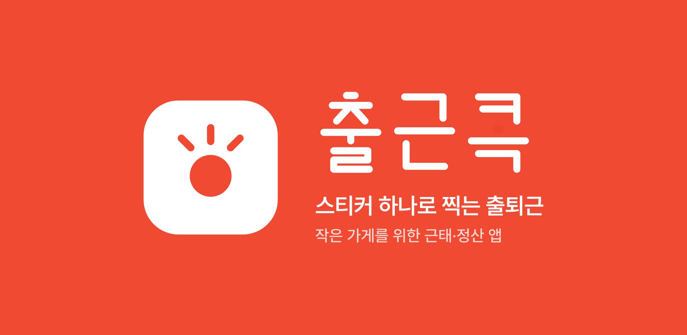
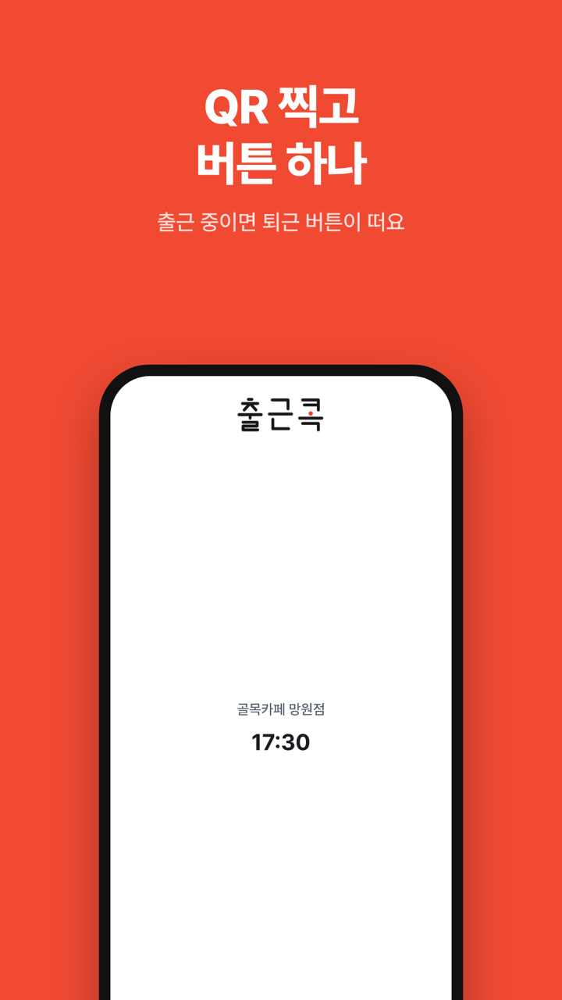
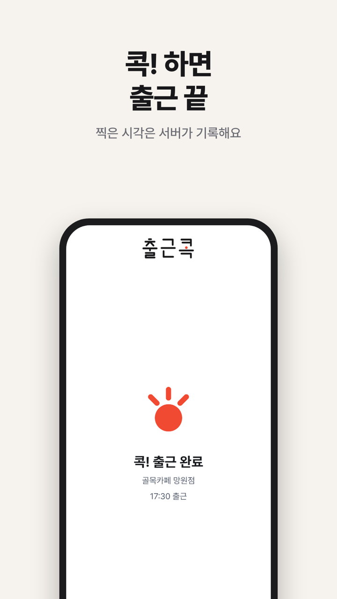
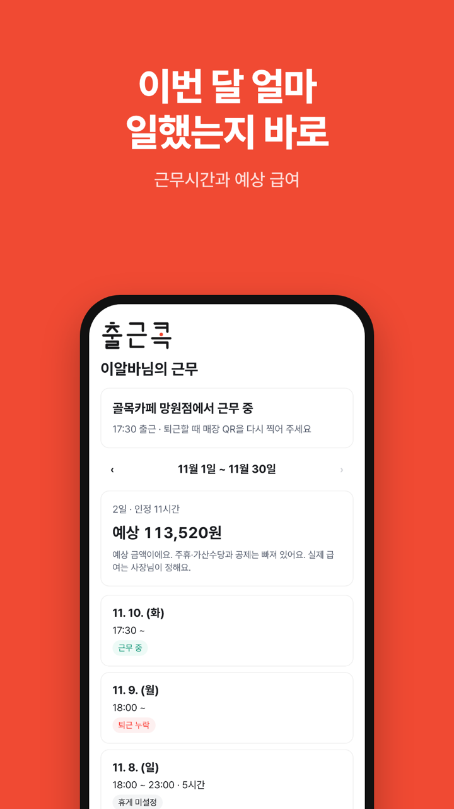
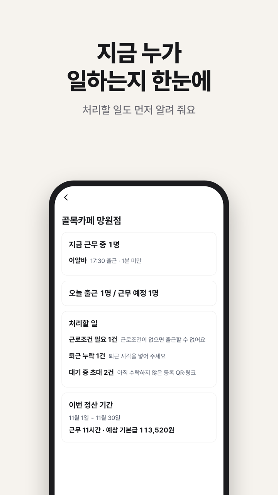
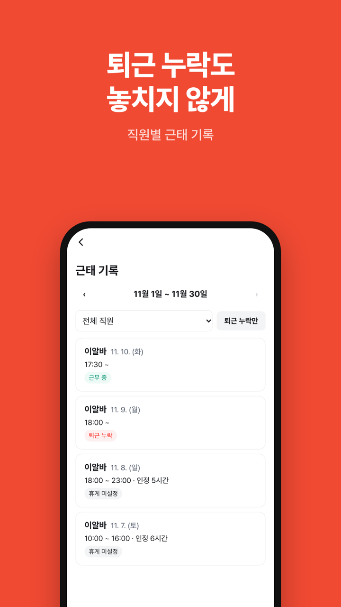
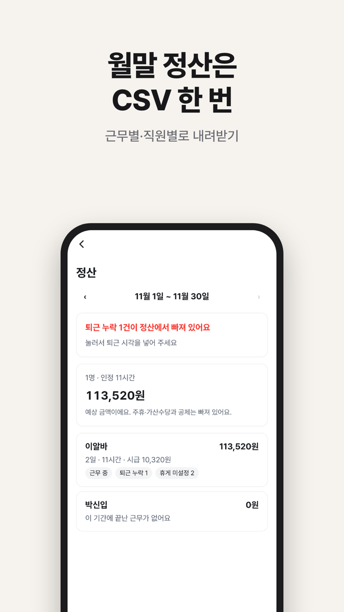

  

  
  
  

  
  
  

## 할 수 있는 것

- 매장 QR 스티커를 찍고 버튼 하나로 출퇴근한다. 출근 위치를 기록하고, 퇴근을 안 찍으면 퇴근 누락으로 바꿔 둔다.
- 직원은 초대 링크로 휴대폰을 한 번 등록한다. 사장님은 휴대폰 인증과 가게 검색으로 매장을 만든다.
- 근로조건(시급·요일별 근무·휴게)을 넣으면 최저임금·휴게·주휴 대상 여부를 안내한다.
- 정산 기간마다 인정 근무시간과 예상 급여를 계산한다.
  - 예상 기본급
  - 예상 주휴수당 (주 15시간 이상, 개근한 주)
  - 연장·야간·휴일 가산수당 (5인 이상으로 신고한 기간)
  - 공휴일·노동절 유급휴일수당
- 직원이 근무 기록 수정을 요청하면 사장님이 승인하거나 반려한다. 정산은 직원별·근무별 CSV로 내려받는다.

금액은 모두 예상치다. 세금·4대보험 공제는 넣지 않는다.
