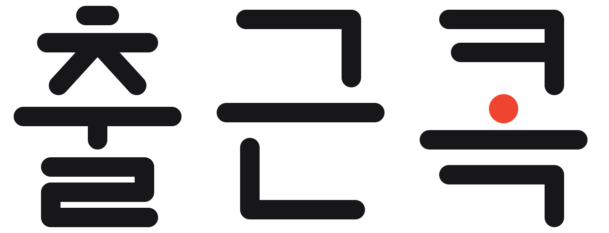
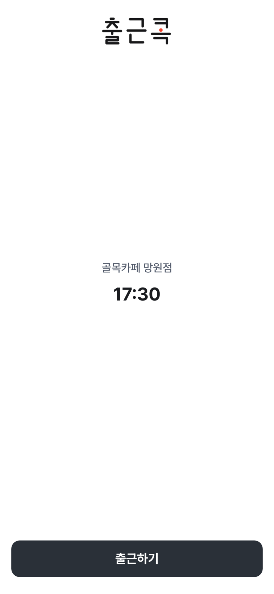
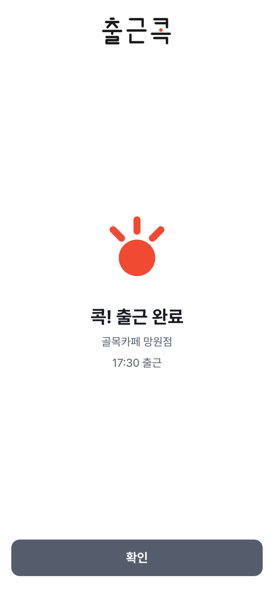
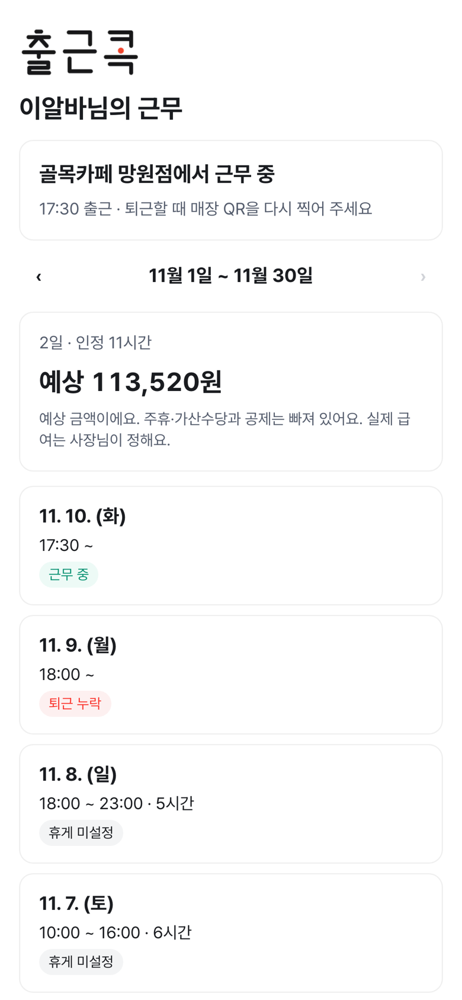
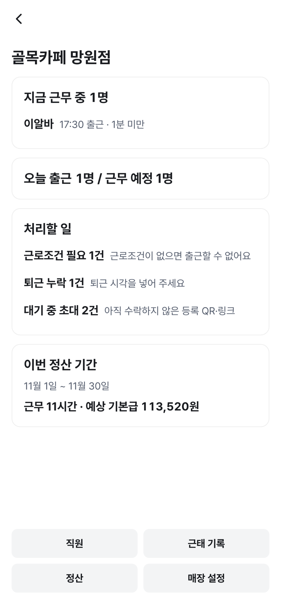
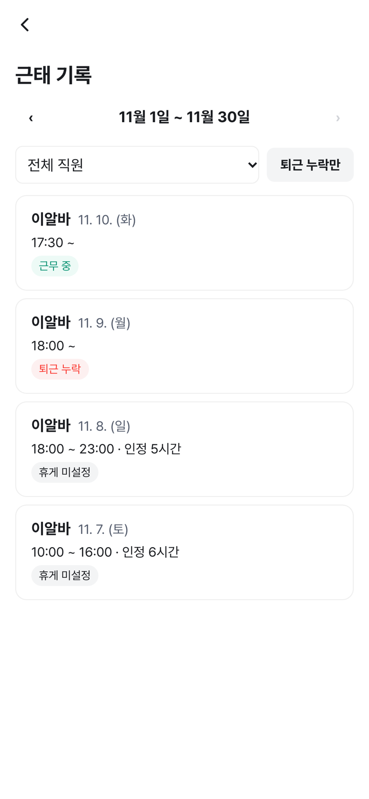
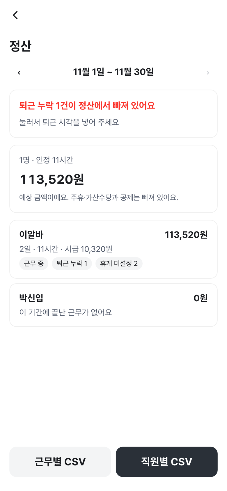

  

<picture>
  <source media="(prefers-color-scheme: dark)" srcset="assets/brand/%EC%B6%9C%EA%B7%BC%EC%BD%95-%EC%9B%8C%EB%93%9C%EB%A7%88%ED%81%AC-%ED%99%94%EC%9D%B4%ED%8A%B8.png" />
  
</picture>

### 매장에 QR 스티커 하나 붙이면, 출퇴근부터 월말 정산까지

작은 음식점·카페·주점 사장님을 위한 근태관리 서비스입니다. 
직원은 휴대폰으로 매장 QR을 **콕** 찍어 출퇴근하고, 사장님은 근무시간과 예상 급여를 한 화면에서 확인합니다.

---

## 이렇게 씁니다

<table>
<tr>
<td width="34%" align="center"></td>
<td>

**1. 사장님이 매장에 QR 스티커를 붙입니다** 
휴대폰 인증 후 가게를 검색해 매장을 만들면 매장 전용 QR이 나옵니다. 별도 단말기는 필요 없습니다.

**2. 직원은 초대 링크로 한 번만 기기를 등록합니다** 
그다음부터는 QR을 찍고 버튼 하나로 출근·퇴근. 지금 상태를 서버가 판단해 출근/퇴근이 자동으로 바뀌어 잘못 누를 일이 없습니다.

**3. 근무시간과 예상 급여가 자동으로 정리됩니다** 
정산 기간별 근무시간·예상 기본급을 계산하고, 퇴근 누락·휴게 미설정·근로조건 누락처럼 사장님이 챙겨야 할 일을 먼저 알려 줍니다.

</td>
</tr>
</table>

## 직원 화면

<table>
<tr>
<td align="center"></td>
<td align="center"></td>
<td align="center"></td>
</tr>
<tr>
<td align="center">QR 찍고 출근하기</td>
<td align="center">콕! 출근 완료</td>
<td align="center">내 근무 · 예상 급여</td>
</tr>
</table>

## 사장님 화면

<table>
<tr>
<td align="center"></td>
<td align="center"></td>
<td align="center"></td>
</tr>
<tr>
<td align="center">지금 근무 중 · 처리할 일</td>
<td align="center">직원별 근태 기록</td>
<td align="center">정산 · CSV 내보내기</td>
</tr>
</table>

## 주요 기능

| | 기능 |
|---|---|
| ⏱️ | **QR 출퇴근** — 매장 QR + 등록된 기기로만 기록, 재시도해도 중복 없음(Idempotency-Key) |
| 📋 | **근태 관리** — 퇴근 누락 자동 전환, 근무 수정 요청·승인 |
| 💰 | **정산** — 요일별 근로조건·시급 이력 기준 예상 기본급, 근무별·직원별 CSV |
| ⚖️ | **노무 검토 안내** — 최저임금·법정 휴게·야간·연장·결근 의심을 검토 시점에 알림 (사업장 규모에 따라 문구 분기) |
| 📱 | **앱 셸** — Expo 앱이 WebView로 웹 화면을 띄우고 QR 스캔·기기 토큰 보관을 맡음 |

> 법령 해석은 설계용 가정이며, 출시 전 공인노무사 검토가 필요합니다. 서비스는 노무 판단을 대신하지 않고 "검토가 필요한 시점"을 안내합니다.
