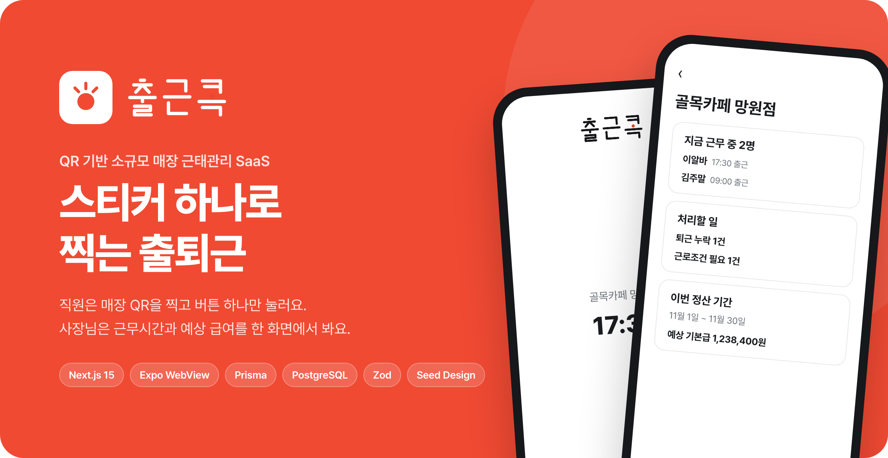
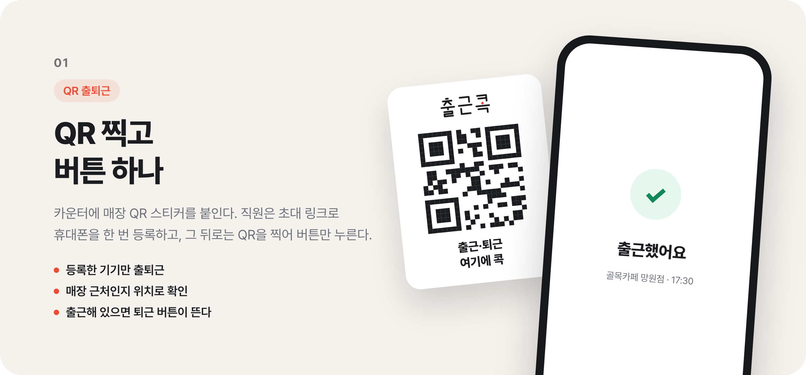
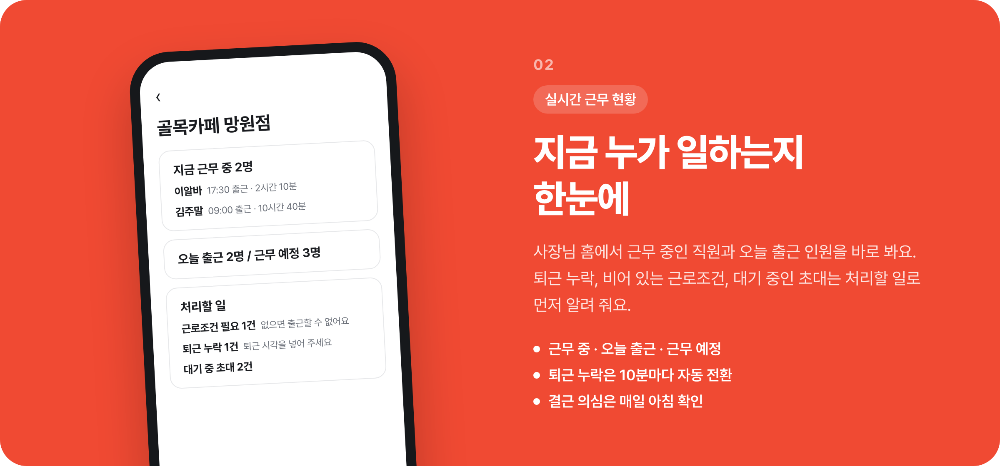
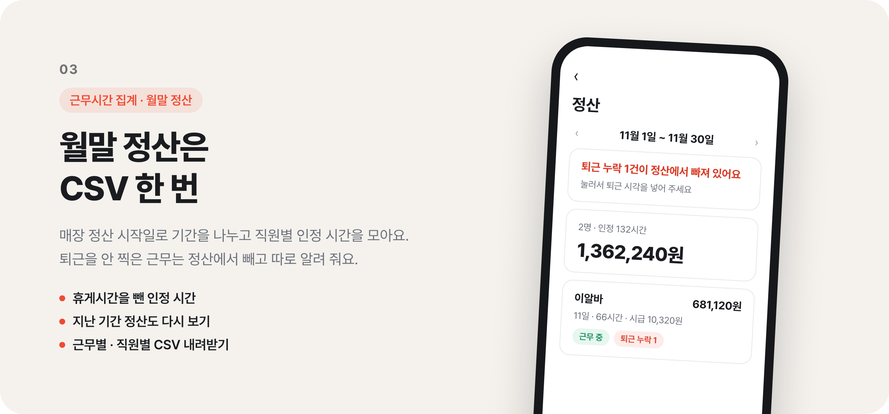
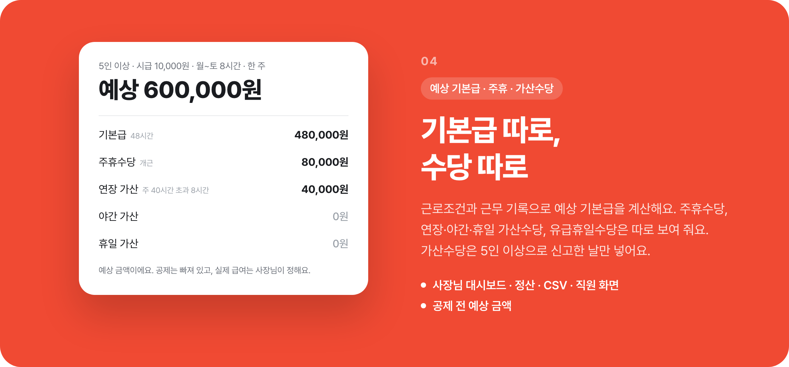
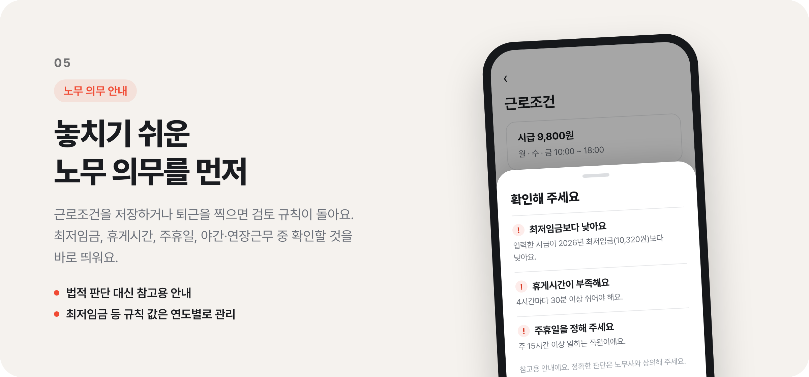
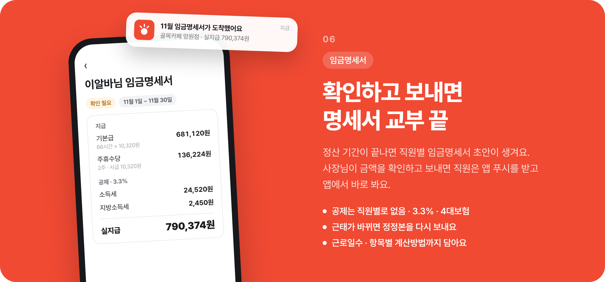

  

  

  

  

  

  

  

## 앱 푸시 (FCM)

환경 변수 `GOOGLE_SERVICES_JSON`(Android `google-services.json` 경로), `GOOGLE_SERVICE_INFO_PLIST`(iOS `GoogleService-Info.plist` 경로)를 주면 Firebase 플러그인이 켜진다. 없으면 푸시 없이 기존처럼 동작한다.
개발 빌드: `cd apps/mobile && GOOGLE_SERVICES_JSON=./google-services.json GOOGLE_SERVICE_INFO_PLIST=./GoogleService-Info.plist npx expo prebuild --clean`
실행: `WEB_ORIGIN=http://<PC LAN IP>:3020 npx expo run:android` (또는 `run:ios`). Expo Go 에서는 푸시가 꺼진다. 두 파일은 `.gitignore` 대상이다.

## QR 카드 저장 (앱)

QR 카드 PDF·PNG 받기는 웹 `SAVE_FILE` 브릿지로 앱에 파일을 넘겨 공유 시트로 저장한다. `expo-file-system`, `expo-sharing` 네이티브 모듈이 들어갔으므로 기존 개발 빌드는 `npx expo prebuild` 후 다시 빌드해야 한다 (OTA 만으로는 안 된다).

## 배치

`/api/internal/jobs/[job]` 를 `Authorization: Bearer $CRON_SECRET` 로 호출한다. 스케줄러(KST 기준)는 레포 밖에서 건다. 레포에는 vercel.json 크론 설정이 없다.

| job | 시각 | 내용 |
| --- | --- | --- |
| `daily-reviews` | 매일 06:00 | 결근 의심 + 최근 근무 재평가 |
| `payslip-drafts` | 매일 06:10 (UTC cron `10 21 * * *`) | 끝난 최근 3개 정산 기간 임금명세서 초안·정정본, `daily-reviews` 뒤에 돈다 |
| `shift-reminders` | 5분마다 (`*/5 * * * *`) | 출근·퇴근 10분 전·정시 푸시 (docs/specs/notifications) |

## 환경 변수 (임금명세서 푸시)

- `PUSH_PROVIDER` (web): `dev`(로그만) | `fcm`. 기본 `dev`.
- `FIREBASE_SERVICE_ACCOUNT` (web): `fcm`일 때 서비스 계정 JSON 한 줄. 시크릿.
- `GOOGLE_SERVICES_JSON`, `GOOGLE_SERVICE_INFO_PLIST` (앱 빌드): 위 "앱 푸시 (FCM)" 참고.
- `QR_TOKEN_ENC_KEY` (web, QR 카드): QR 원문 암호화 키(AES-256-GCM, 32바이트 base64). `openssl rand -base64 32` 로 만든다. production 필수이며 없으면 QR 발급이 `INTERNAL` 로 실패한다. 잃어버리거나 바꾸면 저장된 암호문을 못 풀어 모든 매장이 QR을 재발급해야 한다. 시크릿.

값 예시는 `apps/web/.env.example`.
